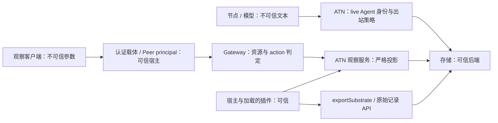

# ATN 威胁模型与读取边界

2026-10-16；范围为 ROADMAP_NEXT_DIRECTIONS_V2 §3/§4。这里的网络是业务分区键，不是租户或认证主体。策略只约束可识别的 artifact 声明与明确登记的读取入口，不证明任意语义泄漏不可行。

## 对手与信任前提

对手可以控制节点的全部工具输入、引用、自然语言和可选传输字段；可以串通、猜测任意 nodeId/taskId/msg 地址、sessionId/networkId，并以一个已认证的非 owner Peer 调用 RPC、重试和伪造额外参数。对手可以读取其被授予的输出，不能据此假设可读所有网络。

宿主进程、加载的插件、存储后端、认证载体及其创建 Peer 的代码是可信计算基。安装恶意宿主插件、修改进程内对象/存储、把不可信请求标记为 owner，会破坏此前提，不属于 ATN 的隔离保证。宿主负责把真实身份绑定到 Peer、安装相应 principal kind 的 remoteAccess 策略并维护授予/撤销；模型提交的身份字段不是授权来源。

## 可引用边界与执行判据

| 契约 | 规则与新增功能判定问题 | 可执行锚点 |
|---|---|---|
| B-LIVE | 模型身份来自实际 live Agent；猜测 ID 不授予身份。新入口是否信任输入中的 sender/role？ | `tests/integration/shifting-evidence-access.test.ts` 的 `ACCESS-03`（伪造 Agent 被拒绝）；agent.test.ts 的 `AUTH-04`、`AUTH-06`；knowledge-feedback.test.ts 的 `KNOWLEDGE-01` |
| B-NAMESPACE | msg/node/task/artifact 重名必须在调用者网络内解析；外网独有不触发外网查找。是否把局部地址当成全局键？ | `NAMESPACE-STRUCTURE` / `NAMESPACE-LIVE`；[分区与授权矩阵](execution-evidence/round-v2-phase1/README.md) |
| B-OUTBOUND | 14 通道检查完整输入；拒绝在提交前发生。新增字段/方法是否绕过策略？ | `BOUNDARY-CHANNELS`、`BOUNDARY-FIELDS`、`BOUNDARY-SYNC`（information-boundary.test.ts）；`BOUNDARY-INVENTORY` |
| B-ATOMIC | 拒绝不追加消息、消耗地址、改权重/步数或产生邮件/模型唤醒。失败是否留下业务写入？ | `SUBSTRATE-ATOMIC`（integration/substrate.test.ts）、`SUBSTRATE-CAPACITY`（unit/substrate.test.ts） |
| B-MODEL-READ | search/visit 仅限实际调用者网络；网络内消息目前全网可读，隐藏作者/权重。新读取是否扩大网络或引入新发现来源？ | `SUBSTRATE-KERNEL`、`SUBSTRATE-ADMISSION`、`SUBSTRATE-RANK` |
| B-OBSERVE | 非 owner 读取须经 Gateway 的资源/action 判定；内容快照与纯元数据权限分开。新增结果字段是否把文本/作者放进元数据？ | `READ-AUTH-*`（integration/observer.test.ts）；`OBSERVER-01/04/06` |
| B-HOST-EXPORT | **明确选择宿主信任假设**：exportSubstrate(networkId) 不校验调用者，可信插件可导出任意网络。新 HTTP/RPC/工具包装是否直接传递用户输入而未授权？若是，越界，须单独授权后才能调用。 | `SUBSTRATE-KERNEL` 的完整 export 断言；`BOUNDARY-INVENTORY` 的宿主读取分类 |

三类读取分别判定：search/visit 校验 ATN 节点身份但不做主体级读侧分区；观察 RPC 由网关校验主体，ATN 负责结果形状；宿主直接调用 observer、network/findBySessionId/exportSubstrate 等原始 API 均不构成沙箱。不得将网关测试扩写成整个宿主的租户隔离证明。

## 观察权限契约

`atn-observation` 资源 ID 为请求的 **sessionId**，不是 networkId。它是“经此会话观察其所属整个网络”的授权能力；拥有子会话 snapshot 授权也能读取该网络中其他节点与任务的投影。宿主授予前必须确认整网内容可向该主体披露，不得直接复用普通单会话阅读权限。不同会话别名需分别授予；未知会话在授权后返回 null，未授权者不得查询其存在性。ATN 不从 nodeId、角色、自报网络 ID 或普通会话权限自动派生授权。

| 主体 / action | 可读范围 |
|---|---|
| owner | Gateway 按上游协议允许所有观察；必须由可信认证载体建立 |
| 非 owner / `atnObserver/snapshot` | 仅显式授予的 atn-observation/sessionId；包含目标、任务文本、事件摘要、节点与会话身份、substrate 子任务/作者/权重/证据链等有界投影 |
| 非 owner / `atnObserver/metadata` | 同一资源上独立授予；只含网络 ID、状态、步数/预算、节点/任务数量与 substrate 容量；无目标/任务/事件/消息文本、节点/作者身份、权重、引用与证据链 |
| 无绑定、只有 global 绑定、其他 session 绑定 | 拒绝；精确参数校验阻止 wire principal、networkId 等额外字段 |
| 进程内可信宿主调用 | 无主体校验；不得直接暴露给不可信请求 |

授权模型使用上游 remoteAccess 的角色 action 与资源绑定；ATN 不注册新的 principal kind 或占用宿主策略槽。资源 reader 由 Remote 方法元数据提供（alpha.4 的 InvocationDescriptor 本身没有 resources 字段）。不注册全局默认 sessionId 字段，避免改变其他服务的资源集合。能力检查针对运行时资源 API/方法 reader，不能比较版本号推定安全。需要经过本仓库网关集成测试的兼容实现；API 存在本身不能证明网关语义。

未来 need-to-know、Topology-as-ACL、舰队读取必须沿用同一 principal/resource/action 模型，并重新列举每个读取资源，不得通过消息权重授予权限。本轮不实现这些后续能力。

## 明确排除的四项

- X-INFERENCE：不防从合法内容推理衍生并传播；extractClaims 不度量语义信息熵。
- X-SIDECHANNEL：不防时间、字节数、调用频率、错误码等物理/协议侧信道。
- X-COLLUSION：不防合法节点在获准范围内合谋互通；不声称自然语言保密性。
- X-EXTERNAL：仅 ATN 登记路径生效；不约束网络外工具、存储域、凭据、模型路由及其他宿主服务。

引用新安全结论时必须同时给出 B-* 判据、测试证据与适用前提。内容截断和凭据模式替换是展示卫生，不是授权或通用脱敏。
